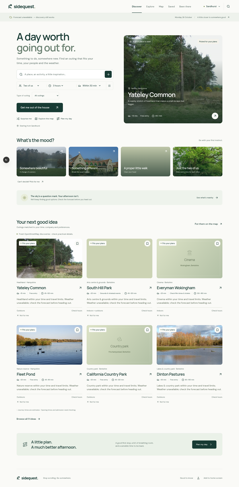

# Discovery and map progress — 26 October 2026

Published code is incremental progress, not a claim that national coverage, photography or recommendation quality is finished. England is the target. The live catalogue still has only the existing regional prepared fallback; the complete source audit has 7,180 normalized records and 45 approved prepared photos.

## Behaviour changed

- Discover has direct activity search, practical preferences, visible map access and Plan my day. Map results show venue thumbnails and more browsable options. The photo fallback remains explicit.
- Catalogue merging uses a name index rather than all-pairs scans. A controlled 7,000-record benchmark improved from about 32 seconds to about 0.2 seconds; this is not a real-device page-load measurement. Capped area records are retained by distance, with saved records preserved.
- Live discovery runs alongside geographic delivery. Local data cannot replace fresher live records, and completed loads no longer become timed-out failures ten seconds later.
- Native point buttons persist through photo, saved and selected-state updates. Cluster labels and coordinates refresh with source data. Photo metadata updates preserve the user's map camera.
- Opted-in everyday categories can appear alongside an activity, with existing cost, time and suitability checks retained. An incidental café does not hide an arts centre, and an incidental playground does not promote a pub into a primary play venue.
- Cloud density uses unbounded procedural screen coordinates and elapsed time. Map panning and zooming cannot move or scale the cloud field. Light rain has visible dark/light contrast; clouds have lit edges and depth. Water geometry is queried after camera movement, using only water fill layers. Static reduced-motion views redraw on weather/dimension changes instead of polling continuously.

## Verification

The production build, type checking, lint and 272 unit tests pass. Seven Python checks pass. Browser checks exercise discovery, persistence, planning, sharing, eligibility, static/live precedence, real MapLibre interaction and actual GPU pixels on a deterministic local geography fixture. A full run passed 32 of 33 cases; its cloud screenshot assertion included the map and cards composited through the transparent canvas. The weather fixture now isolates the atmospheric layer on an opaque test-only background; targeted weather reruns verify the independent field. GPU capture cases receive a 90-second test budget for software rendering. Live map-provider uptime and real nationwide outing quality are not established by fixtures.

Desktop (1440px) and phone (390px) captures have no horizontal overflow and no browser errors. The screenshots use existing curated records and block live enrichment; they deliberately retain missing-photo states. Photography and geographic coverage remain the material release limitations.

## Sources and remaining work

See [England catalogue research](england-catalogue.md) for the comparison of OSM extracts, Overture, All the Places, OpenFreeMap, Geoapify and Openverse, with official GitHub sources. The environment still requires allowed network access to Geofabrik, Wikimedia/Wikidata and venue websites before actual national acquisition and fresh photo sourcing can be tested. Geoapify offers a free key for small-area testing; it could enable a secondary listings source, but no Geoapify integration or nationwide quota is claimed in this release.
